# User Manual — Sistem Jejak GPL

This manual explains how to use **Sistem Jejak GPL**, the FAMA portal for tracing exported agricultural produce. Screens in this manual were taken from the live site:

[https://jejakgpl.metadatasystem.my](https://jejakgpl.metadatasystem.my)

The screens are in Malay. This manual uses those same labels, so you can follow them on the page.

Figures on the dashboards (how many QR codes, how many applications) change as people use the system. The pictures show the site as it stood when this manual was written.

## What the system does

An **usahawan** records an export. **Pegawai FAMA** reviews it. After FAMA approves, the public can open a product page from the QR code on the label.

A QR can exist before approval. Until FAMA approves, the public page says **QR Belum Diaktifkan** and shows only the QR ID. Approval turns that same QR **Aktif** and opens the traceability page. Rejection leaves the QR inactive.

After a QR is active, the company holding the lot can split the remaining quantity into smaller lots. Each piece gets its own QR, linked back to the original batch. The public page shows those stops under **Jejak pecahan**.

DagangNet and iFAMA in this version are lookup lists inside the prototype. Certificate files are copies the company uploads. There is no live check with a certificate authority, and there is no connection to a label printer.

## Who uses it

| Person | What they do |
|---|---|
| Usahawan | Keeps the company profile, files an export application, downloads the QR, and splits a lot |
| Pegawai FAMA | Monitors the system, approves or rejects applications, and can register a vendor and issue an active QR directly |
| Public | Opens a QR link. No login. Sees the product page only when the QR is active |

On the sign-in screen the role switch must match the account. **USAHAWAN** is for the company user. **FAMA** is for the officer.

## Contents

1. [Open the system and sign in](#1-open-the-system-and-sign-in)
2. [Register as an usahawan](#2-register-as-an-usahawan)
3. [Register as Pegawai FAMA](#3-register-as-pegawai-fama)
4. [Usahawan — home](#4-usahawan--home)
5. [Usahawan — company profile](#5-usahawan--company-profile)
6. [Usahawan — applications](#6-usahawan--applications)
7. [Usahawan — QR codes](#7-usahawan--qr-codes)
8. [Usahawan — split a lot](#8-usahawan--split-a-lot)
9. [Usahawan — audit trail](#9-usahawan--audit-trail)
10. [Pegawai FAMA — monitoring](#10-pegawai-fama--monitoring)
11. [Pegawai FAMA — review and decision](#11-pegawai-fama--review-and-decision)
12. [Pegawai FAMA — companies and direct QR](#12-pegawai-fama--companies-and-direct-qr)
13. [Public traceability page](#13-public-traceability-page)
14. [Phone layout](#14-phone-layout)
15. [Statuses](#15-statuses)
16. [Demonstration accounts](#16-demonstration-accounts)
17. [What this version does not do](#17-what-this-version-does-not-do)
18. [Messages you may see](#18-messages-you-may-see)

---

## 1. Open the system and sign in

Open [https://jejakgpl.metadatasystem.my](https://jejakgpl.metadatasystem.my). The home page sends you to **Log Masuk**.

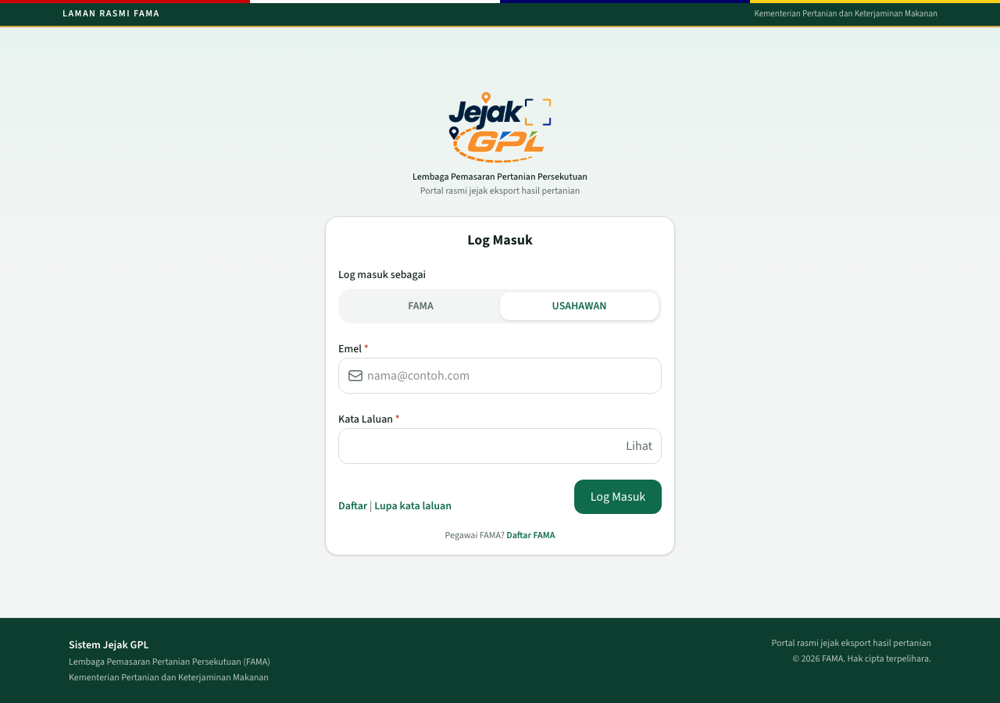

1. Under **Log masuk sebagai**, choose **USAHAWAN** or **FAMA**.
2. Enter **Emel** and **Kata Laluan**.
3. **Lihat** shows the password.
4. Click **Log Masuk**.

An usahawan lands on **Utama**. An officer lands on **Utama FAMA**.

**Daftar** starts usahawan registration. **Daftar FAMA** starts officer registration. **Lupa kata laluan** explains that email reset is not connected yet. Use an existing account, or register again through the company or staff lookup.

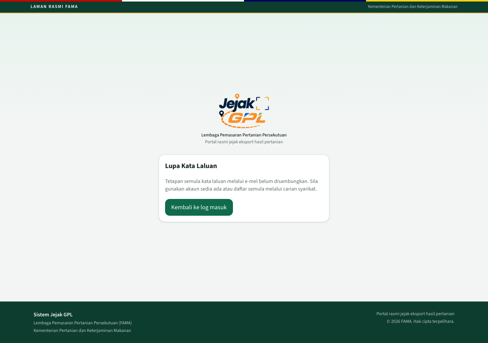

**Log Keluar** is at the bottom of the left menu.

The bell in the header shows how many notices are still unread. It is a count, and it does not open a separate inbox.

If one login is tied to more than one company, a **Syarikat aktif** list appears above the page. Choosing a company switches the records you are working on.

---

## 2. Register as an usahawan

From **Log Masuk**, click **Daftar**. Registration has four steps. The lookup uses the prototype company list.

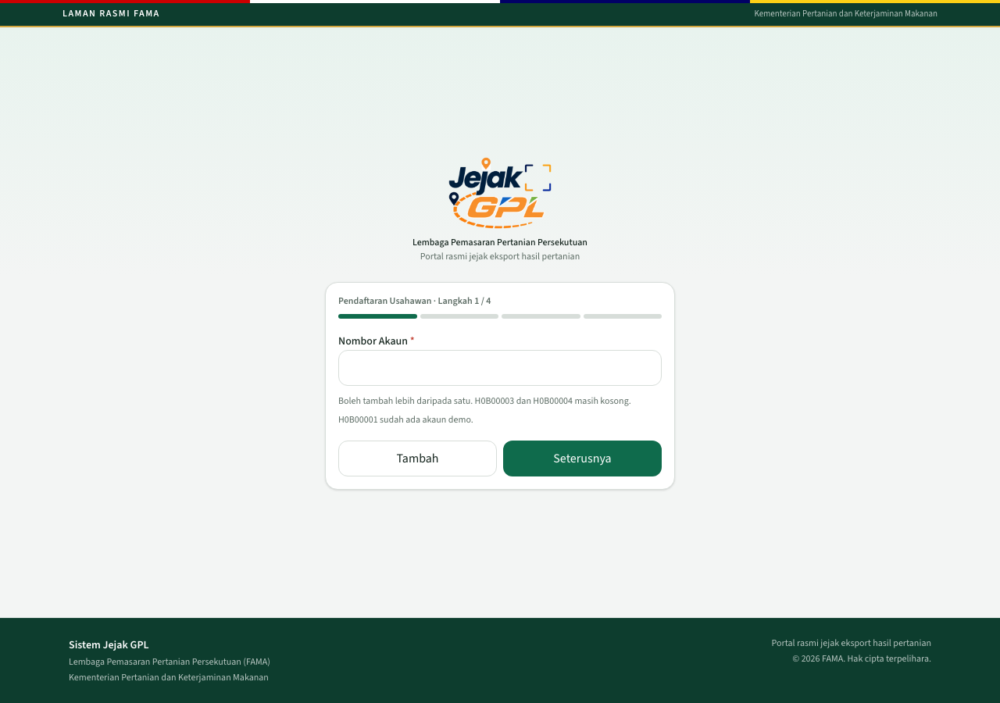

### Step 1 — Nombor Akaun

Type the DagangNet account number and click **Seterusnya**. **Tambah** puts the number on a list so one login can cover more than one company. Add every number first, then click **Seterusnya**.

A number that is not in the list shows **Tiada rekod dijumpai**.

On this site, `H0B00001` already belongs to the ABC Fruits demonstration account. The screen says `H0B00003` and `H0B00004` are still free. Finish registration only when you mean to create a new login. Stopping after step 2 leaves the database unchanged.

### Step 2 — Maklumat Syarikat

The lookup returns the company name, account number, email, and status. Check that this is the right company, then click **Seterusnya**.

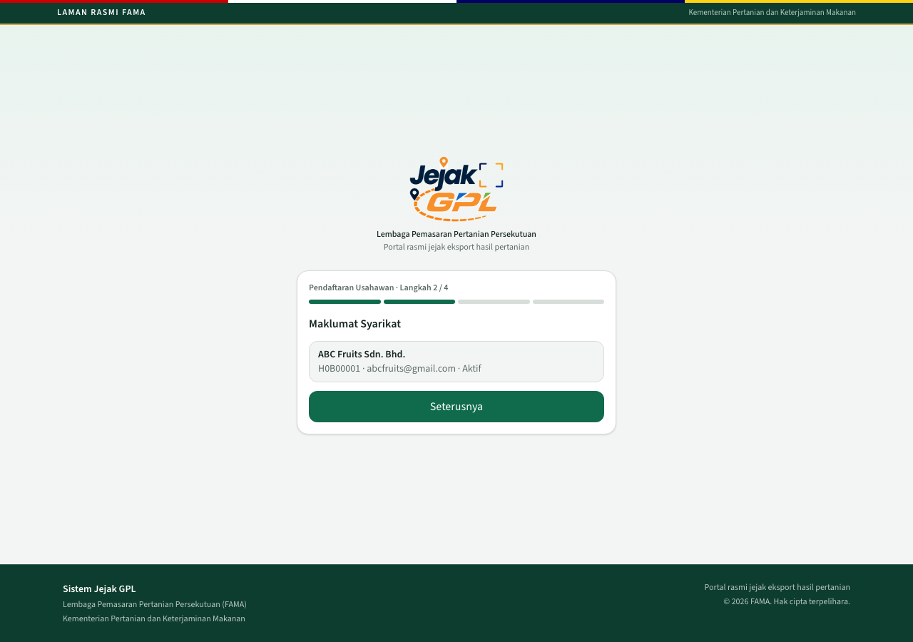

### Step 3 — Maklumat Pengguna

Enter the user’s identity card number and name. The sample text already in the boxes is placeholder text. Replace it with the real user.

**Peranan dalam rantaian** is stored on the company and later appears on **Jejak pecahan**:

| Choice | Meaning on the chain |
|---|---|
| Pengeluar | Producer. First role. |
| Pengeksport | Exporter. Same role or after Pengeluar. |
| Pemborong | Wholesaler. Same role or after Pengeksport. |
| Pengimport | Importer. Same role or after Pemborong. |
| Peruncit | Retailer. Same role or after Pengimport. |
| Lain-lain | A custom layer. **Nama lapisan** is required, for example Pengumpul. This role cannot send or receive a pecahan. |

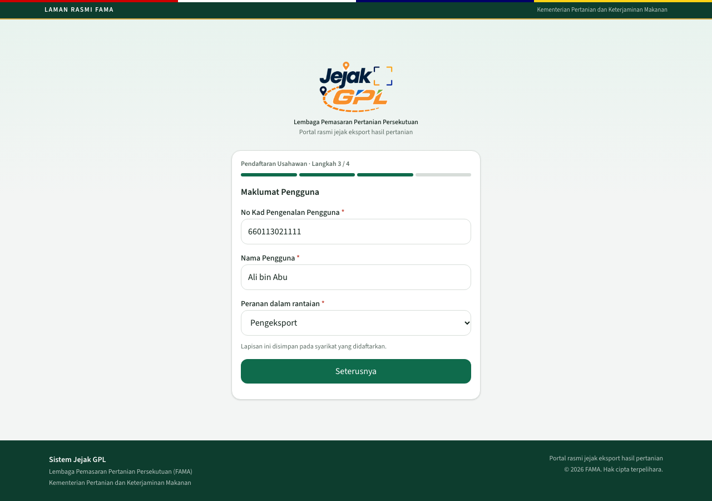

### Step 4 — Kata Laluan

The login email is the email of the **first** company you added. Set a password of at least 8 characters, confirm it, and click **Daftar**.

If the passwords do not match, or no company was added, the page asks you to check the password and the user details. For **Lain-lain**, an empty layer name shows **Nama lapisan diperlukan untuk Lain-lain.**

---

## 3. Register as Pegawai FAMA

From **Log Masuk**, click **Daftar FAMA**. Registration has three steps. The lookup uses the prototype iFAMA staff list.

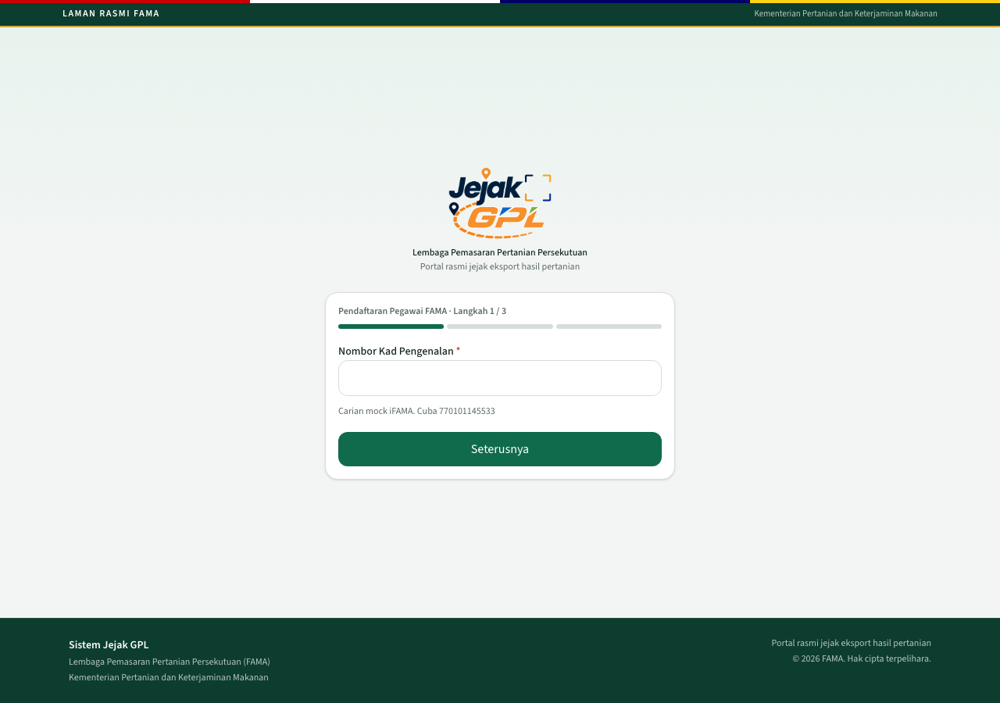

1. Enter **Nombor Kad Pengenalan** and click **Seterusnya**.
2. Step 2 shows the officer’s name, email, and jawatan. These fields are read-only.
3. Step 3 asks for a password and a confirmation, at least 8 characters. Click **Daftar**.

An identity number that is not in the list shows **Tiada rekod dijumpai**. A password problem shows **Sila semak kata laluan.**

The demonstration officer `770101145533` already has an account. The picture below is the confirmation step only. Stop there unless you are creating a new officer.

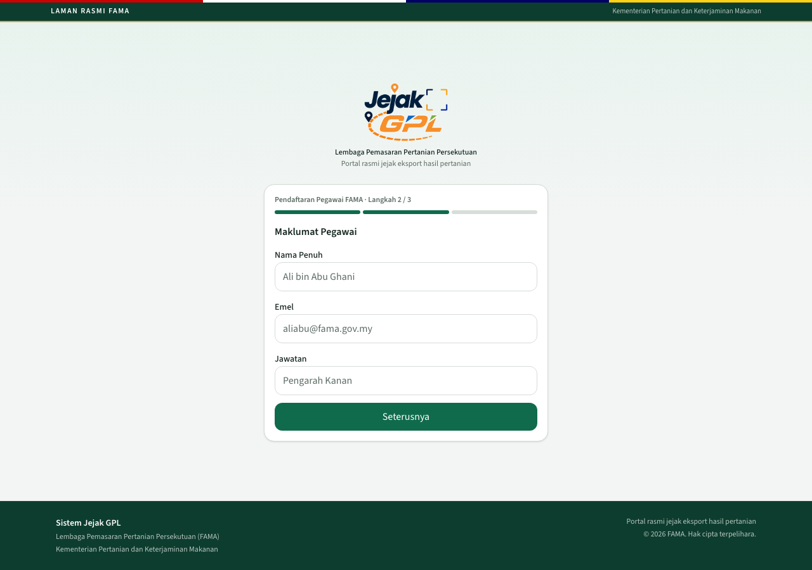

---

## 4. Usahawan — home

After sign-in the usahawan sees **Utama**.

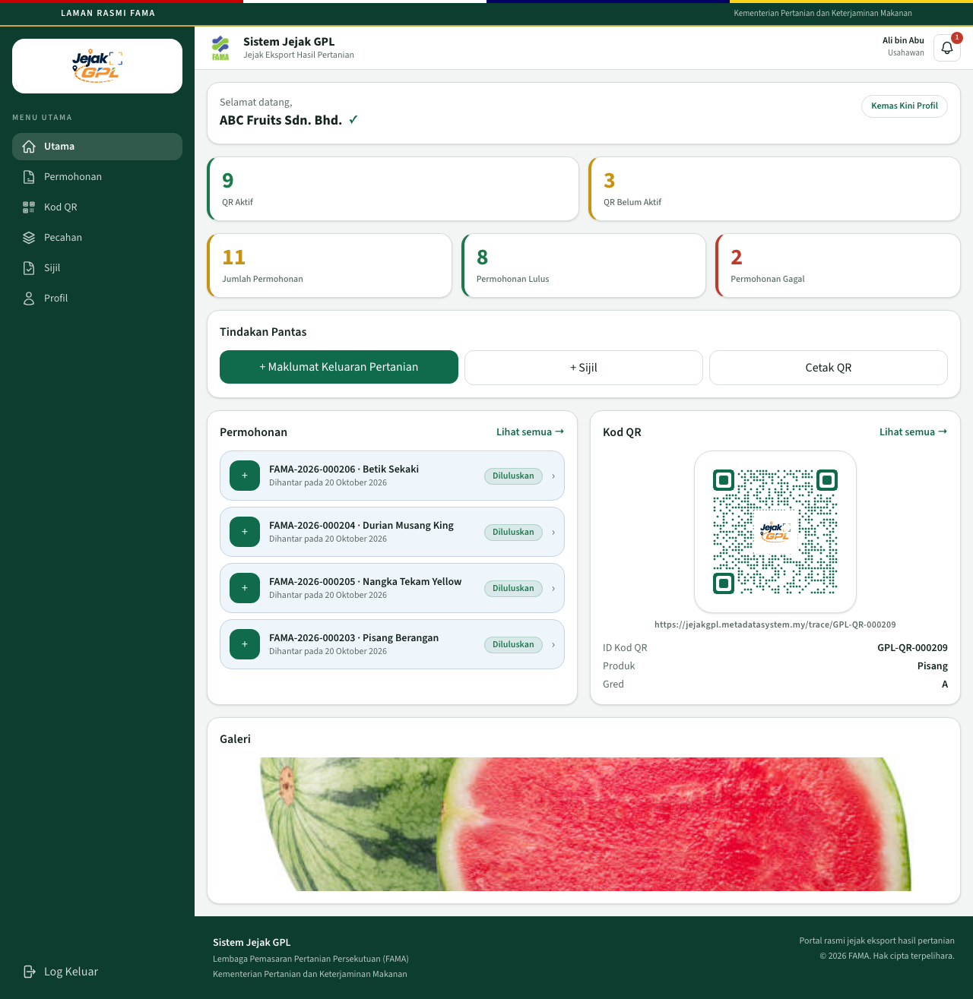

The tick beside the company name means the account is tied to a company record.

| Item | Meaning |
|---|---|
| QR Aktif | QR codes the public can open |
| QR Belum Aktif | QR codes that exist, still waiting for approval or rejected |
| Jumlah Permohonan | All applications for this company |
| Permohonan Lulus | Approved |
| Permohonan Gagal | Rejected |
| Tindakan Pantas | Shortcuts to produce, certificates, and QR printing |
| Permohonan | The latest applications. **Lihat semua** opens the full list |
| Kod QR | One QR from this company, with its public link |
| Galeri | The latest company photo |

The left menu on a computer:

- **Utama**
- **Permohonan**
- **Kod QR**
- **Pecahan**
- **Sijil**
- **Profil**

**Kemas Kini Profil** opens the company profile.

---

## 5. Usahawan — company profile

Open **Profil**, or **Kemas Kini Profil**. Four tabs sit across the top: **Syarikat**, **Keluaran**, **Sijil**, **Galeri**.

### Syarikat

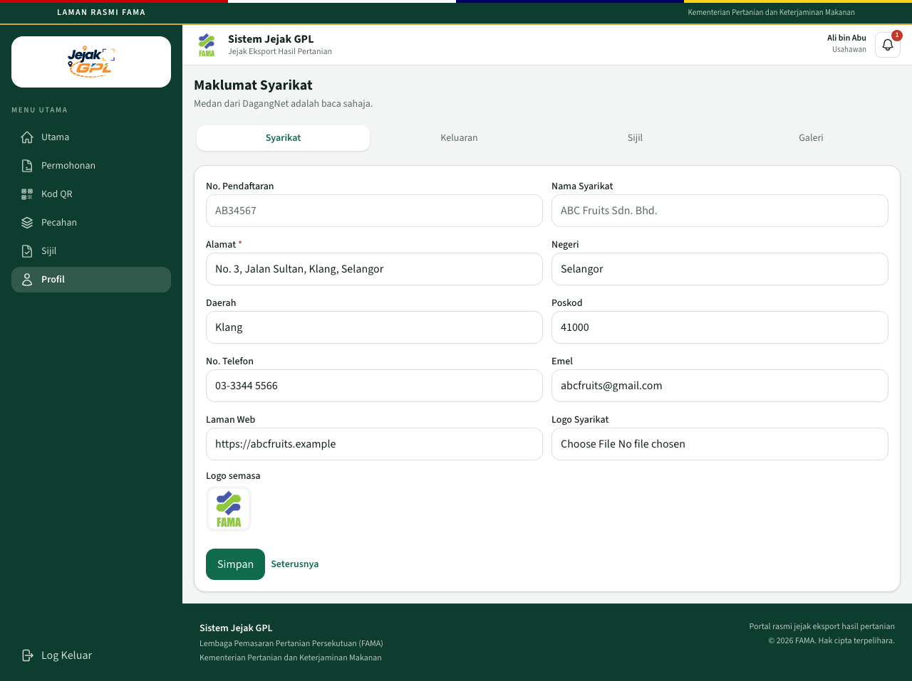

**No. Pendaftaran** and **Nama Syarikat** come from DagangNet and stay read-only. The usahawan can update:

- Alamat, Negeri, Daerah, Poskod
- No. Telefon, Emel, Laman Web
- Logo Syarikat (JPG, PNG, or WEBP)

Click **Simpan** to keep the changes. **Seterusnya** moves to **Keluaran**.

### Keluaran

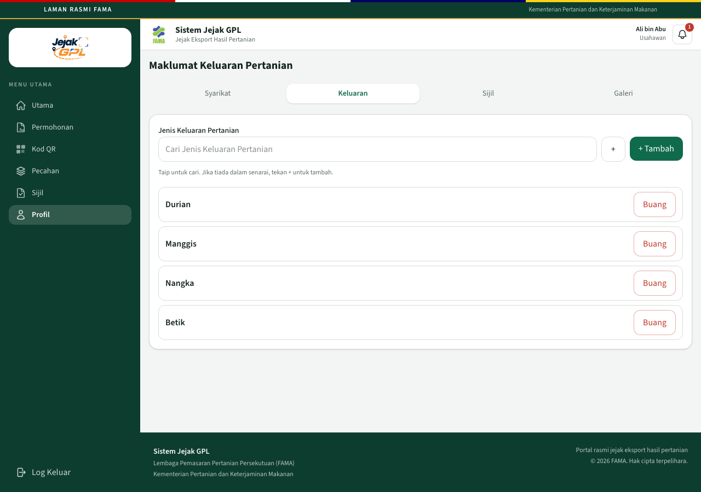

This is the list of produce the company exports. Type to search. If the name is not in the list, press **+** to add it, then **+ Tambah**. **Buang** removes a row from the company list.

### Sijil

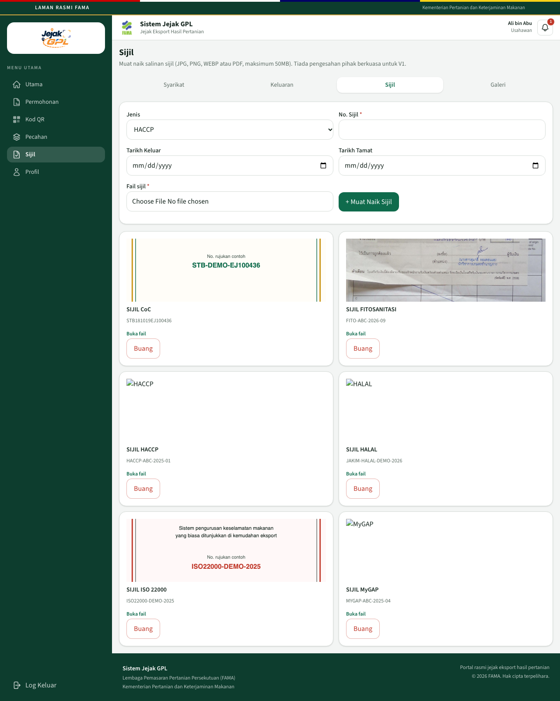

Upload a copy of a certificate. Types are HACCP, MyGAP, CoC, FITOSANITASI, ISO 22000, and HALAL.

| Field | Notes |
|---|---|
| Jenis | Certificate type |
| No. Sijil | Required |
| Tarikh Keluar / Tarikh Tamat | Optional |
| Fail sijil | JPG, PNG, WEBP, or PDF, maximum 50MB |

Click **+ Muat Naik Sijil**. **Buka fail** opens the uploaded file. **Buang** deletes that copy.

These are uploaded copies. This version does not call a certificate authority. A CoC uploaded here is what you later pick on an export application as **No Sijil CoC**.

### Galeri

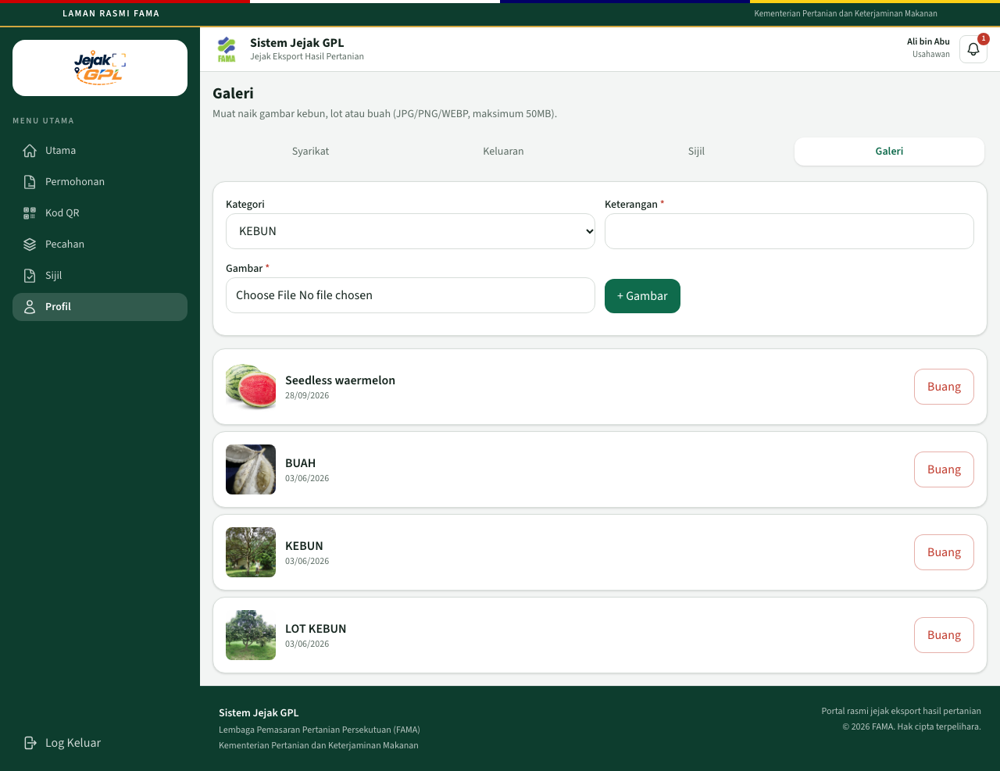

Upload photos of the farm, the lot, or the fruit. Categories are **KEBUN**, **LOT KEBUN**, and **BUAH**. Add a **Keterangan**, choose a JPG, PNG, or WEBP up to 50MB, and click **+ Gambar**.

Gallery photos support the company profile. The picture printed on a public QR is chosen later, on the application, as **Gambar paparan QR**.

---

## 6. Usahawan — applications

Open **Permohonan**.

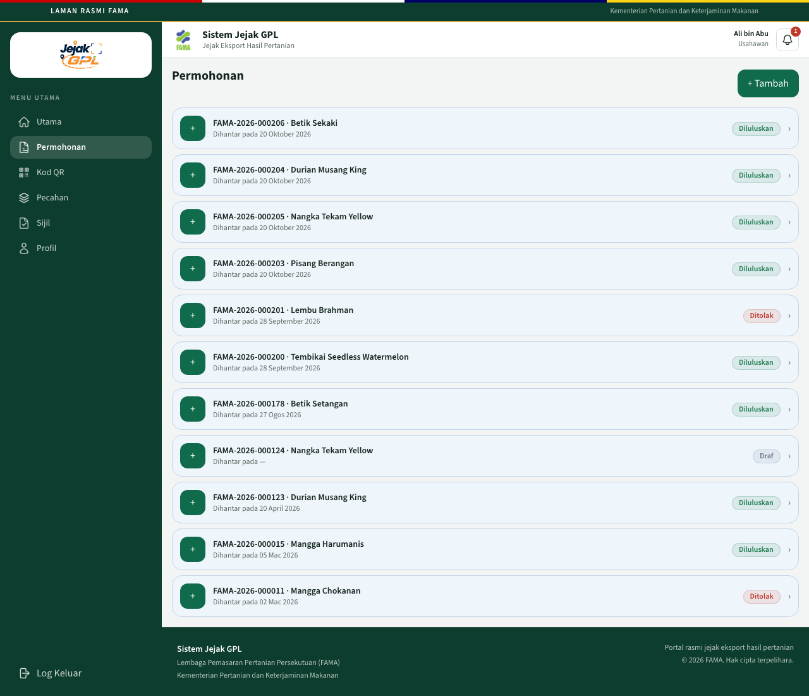

Each row shows the application number, produce, variety, the date it was sent, and the status. **+ Tambah** starts a new application.

### Choose the kind of QR

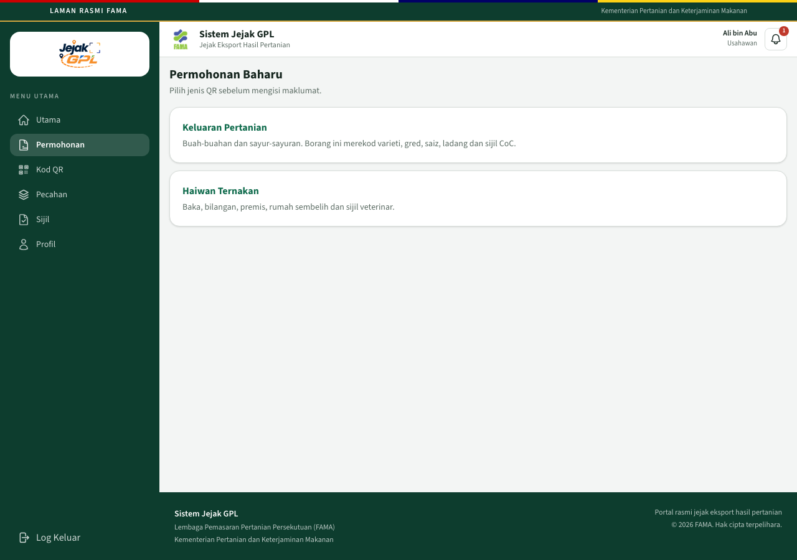

| Choice | What you record |
|---|---|
| Keluaran Pertanian | Fruit and vegetables: variety, grade, size, farm, and CoC |
| Haiwan Ternakan | Breed, head count, premises, abattoir, and veterinary certificate |

The page says an inactive QR is generated when the draft is saved.

### Keluaran Pertanian


**Simpan** and **Seterusnya** stay on screen while you scroll. Both save the draft. **Seterusnya** is the main save on a new application.

**Maklumat Keluaran**

| Field | Required | Notes |
|---|---|---|
| Nama Syarikat | — | Filled in, read-only |
| Jenis Keluaran Pertanian | Yes | Search, or press **+** to add a name |
| Varieti | Yes | |
| Gred | Yes | |
| Saiz | No | |
| Bilangan Eksport / Berat (kg) | Yes | This quantity is the lot you can split later |
| Destinasi | Yes | Destination country |
| No Sijil CoC | Yes | Pick a CoC already uploaded under **Sijil** |
| Gambar paparan QR | No | JPG, PNG, or WEBP, maximum 50MB. This image is the one on the public page |

**Maklumat Eksport**

| Field | Required | Notes |
|---|---|---|
| Tarikh Eksport | No | |
| Nama Ladang | Yes | |
| No. Lot | No | |
| Lokasi ladang | No | |
| Latitud / Longitud | No | When both are saved, a map is shown. Click the map to move the pin. The coordinates update with the pin |
| Pengimport | Yes | |
| Alamat Pengimport | Yes | |

**Tukar jenis** goes back to the choice between produce and livestock.

### Haiwan Ternakan

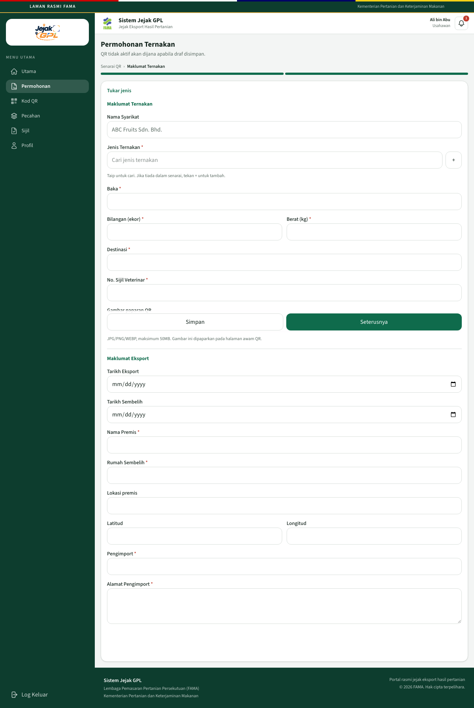

**Maklumat Ternakan:** Jenis Ternakan, Baka, Bilangan (ekor), Berat (kg), Destinasi, No. Sijil Veterinar, and an optional display image.

**Maklumat Eksport:** Tarikh Eksport, Tarikh Sembelih, Nama Premis, Rumah Sembelih, Lokasi premis, coordinates, Pengimport, and Alamat Pengimport.

### After the draft is saved

You return to the application. Status is **Draf**. A **Kod QR** card appears with status **Belum Aktif**.

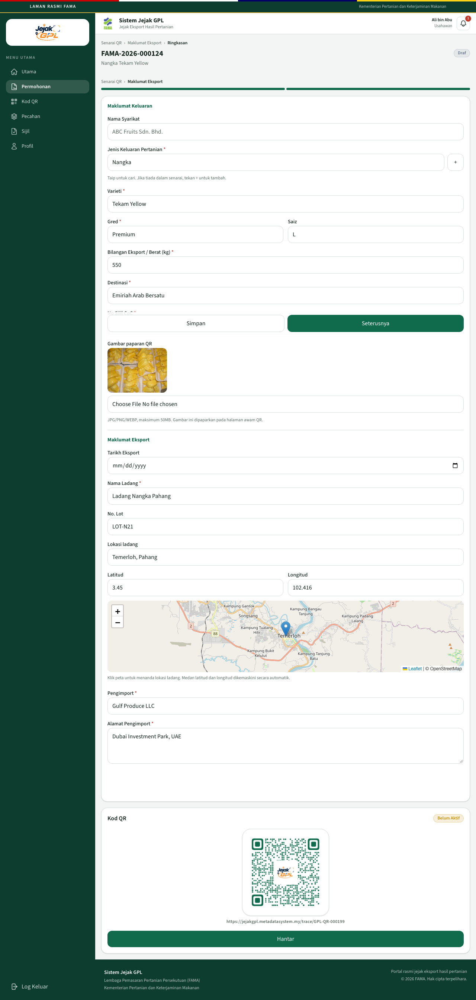

While the status is **Draf** you can still edit the fields and click **Simpan**. **Hantar** sends the application to FAMA. After **Hantar**:

- The form locks.
- The status becomes **Dihantar**.
- The QR stays **Belum Aktif**.

Sending the application does not activate the QR. FAMA still has to approve it.

A draft that has no QR yet shows **Jana QR**. Saving the form normally creates the QR for you.

### Approved application

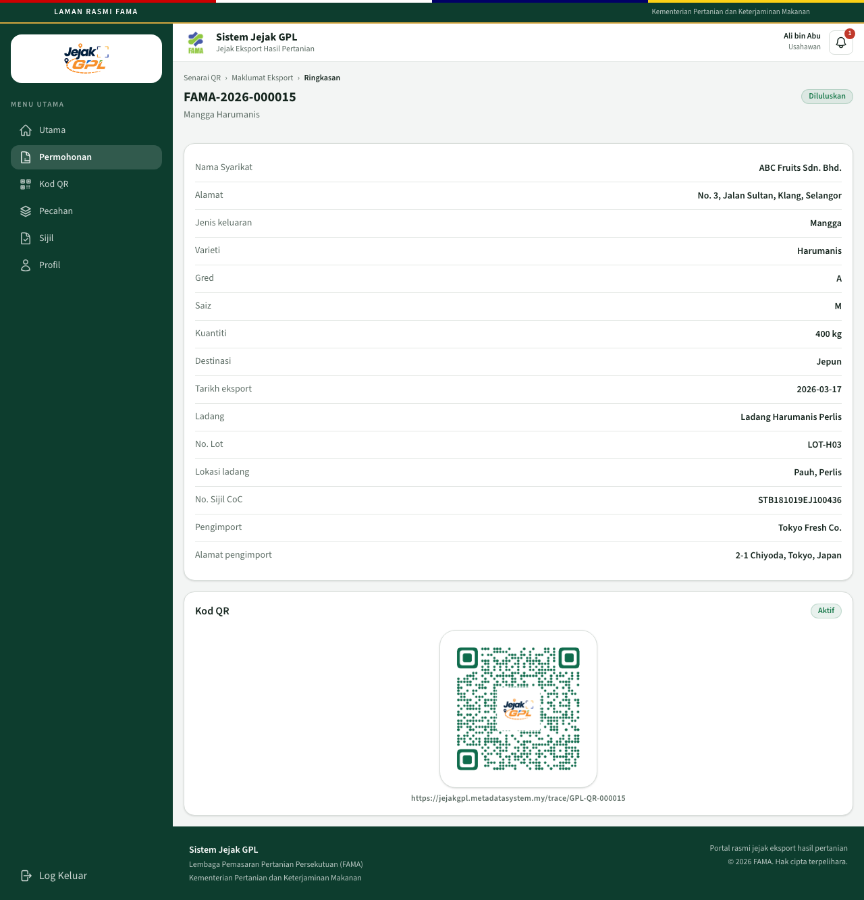

Status **Diluluskan**. The QR badge is **Aktif**. The summary is read-only. The line under the title says the application is no longer a draft and cannot be edited.

### Rejected application

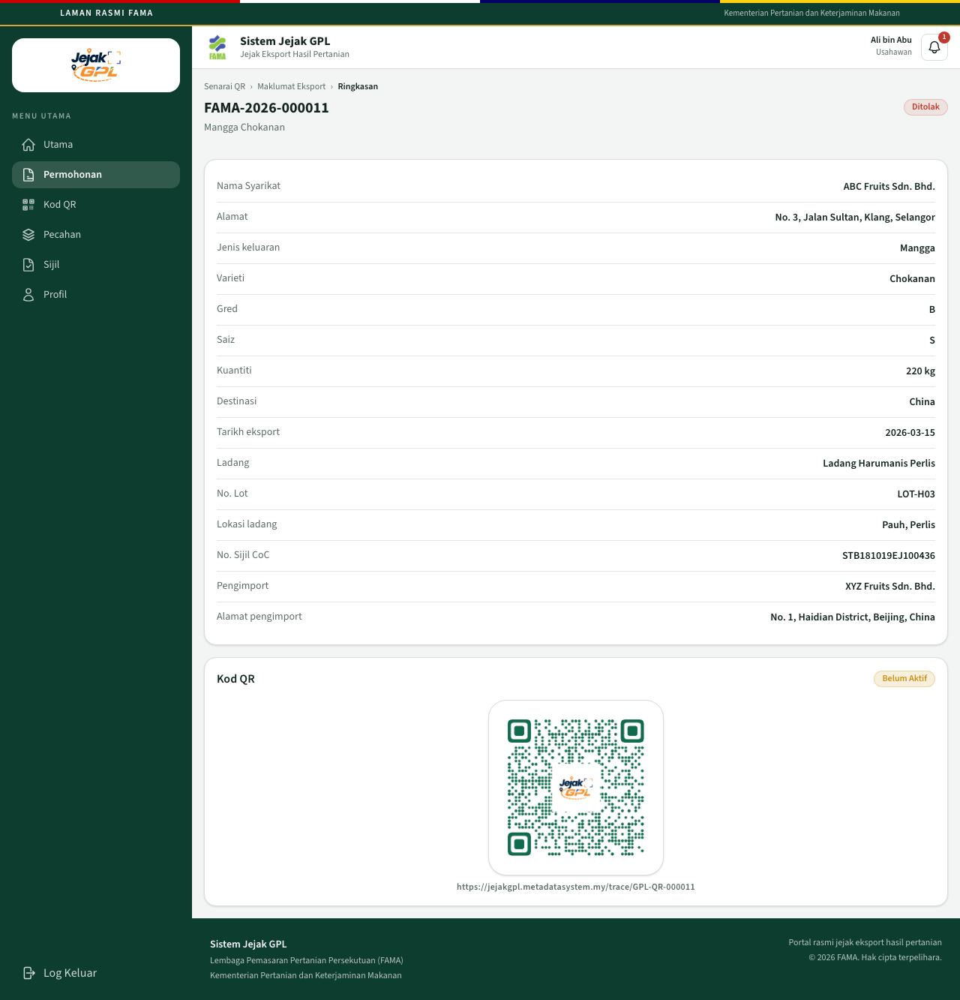

Status **Ditolak**. The QR stays **Belum Aktif**. The reason is stored with FAMA’s decision. A rejected application cannot be edited and sent again. File a new application if the export should be reviewed again.

---

## 7. Usahawan — QR codes

Open **Kod QR**.

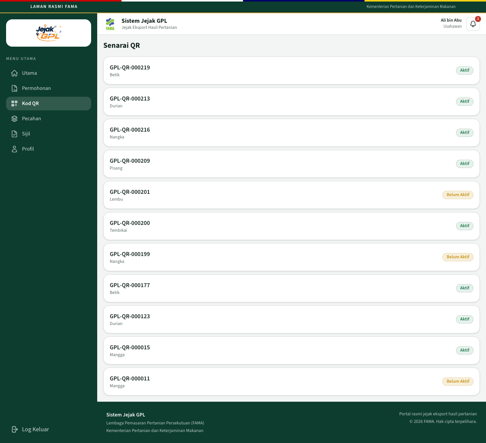

Each row is a QR code, the produce, and **Aktif** or **Belum Aktif**. Open a row for the detail.

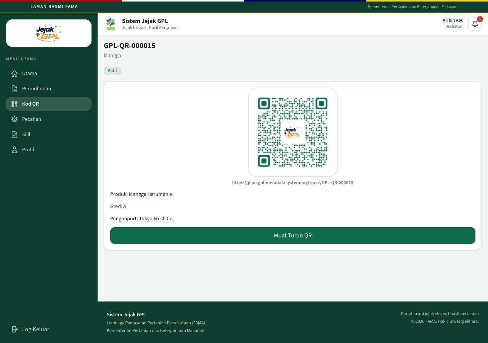

The detail shows the public link, the product, the grade, the importer, and **Muat Turun QR**.

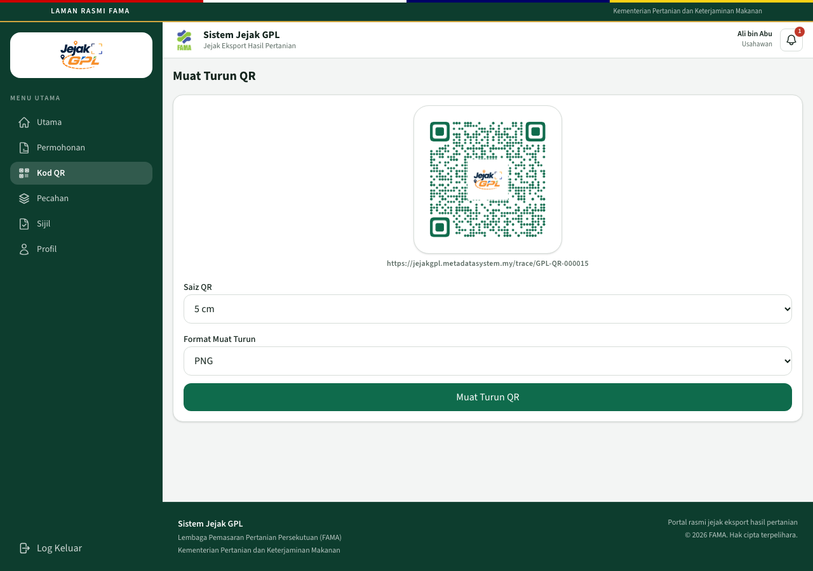

| Option | Choices |
|---|---|
| Saiz QR | 3 cm, 5 cm, or Custom (8 cm) |
| Format Muat Turun | PNG or PDF |

Click **Muat Turun QR**. The file encodes the same public address, for example `https://jejakgpl.metadatasystem.my/trace/GPL-QR-000015`. The size is for the label artwork. The system does not send the file to a printer.

You can download a QR that is still **Belum Aktif**. Scanning it before approval shows the inactive page, not the product page.

---

## 8. Usahawan — split a lot

The first QR is the whole shipment. **Pecahan** is where that shipment is broken into smaller lots. You do not file a new application for each box.

Open **Pecahan**.

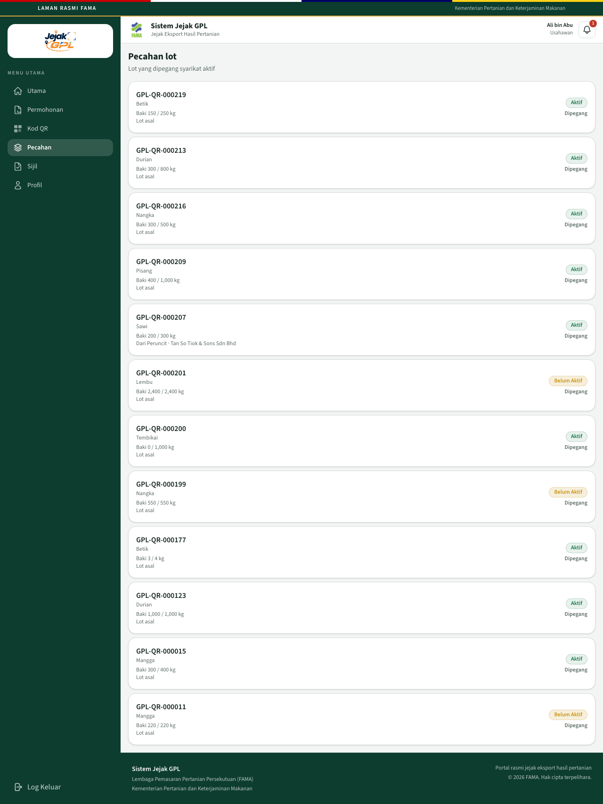

A row shows the QR, the produce, **Baki** (what is left) against the original quantity, and whether it is the **Lot asal** or came from another company. **Dipegang** means the company still holds it. A QR that is **Belum Aktif** is listed, and it cannot be split until FAMA has approved it.

Open an active lot.

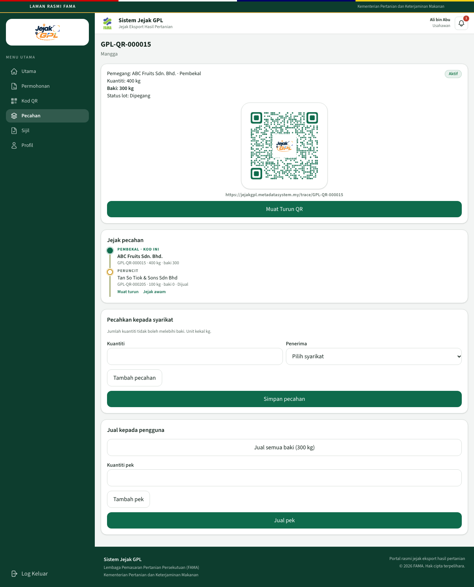

The card shows the holder, the chain role, the original quantity, the balance, and **Status lot**. **Jejak pecahan** is the line of companies. **Kod ini** marks the lot you are looking at. In the picture, ABC Fruits still holds the mango batch, and 100 kg has already moved to a retailer and been sold.

### Give a quantity to another company

Under **Pecahkan kepada syarikat**:

1. **Kuantiti** — kilograms, or the unit of that lot. The pieces together cannot exceed **Baki**.
2. **Penerima** — the company that should hold the next stop. The list shows that company’s chain role and name.
3. **Tambah pecahan** adds another row, so one save can create several pieces.
4. **Simpan pecahan**.

The page confirms the split. Your balance drops. Each new QR is **Belum Aktif** and labelled **Menunggu penerimaan** until that company accepts it. You can still **Muat turun** the new QR and hand the label over. The new code is not in the recipient’s **Pecahan** list until they accept it.

### The recipient accepts

1. The recipient signs in as **USAHAWAN**.
2. Under **Kod QR**, the new code is listed as waiting.
3. They open **Jejak awam** for that QR, or open the public link while they are signed in.

That visit accepts the lot. The public page then shows the product, and **Jejak pecahan** marks their stop as **Kod ini**. The QR becomes **Aktif**. They can split only the quantity they accepted.

Before acceptance, a visitor who is not signed in as that company sees **QR Menunggu Penerimaan**. The product page stays hidden. The message asks the receiving company to sign in and open the link again.

### Sell to a consumer

**Jual kepada pengguna** is a sale with no company login on the new code.

- **Jual semua baki** marks this whole QR as sold and blocks further splits.
- **Jual pek** creates a consumer QR for each quantity you type. **Tambah pek** adds another pack. A consumer QR is active immediately. The chain ends at **Consumer**.

Only the company that currently holds the lot can split or sell it. Another company’s login shows that the current holder must do it.

---

## 9. Usahawan — audit trail

The audit trail is not in the left menu. Open:

[https://jejakgpl.metadatasystem.my/exporter/audit](https://jejakgpl.metadatasystem.my/exporter/audit)

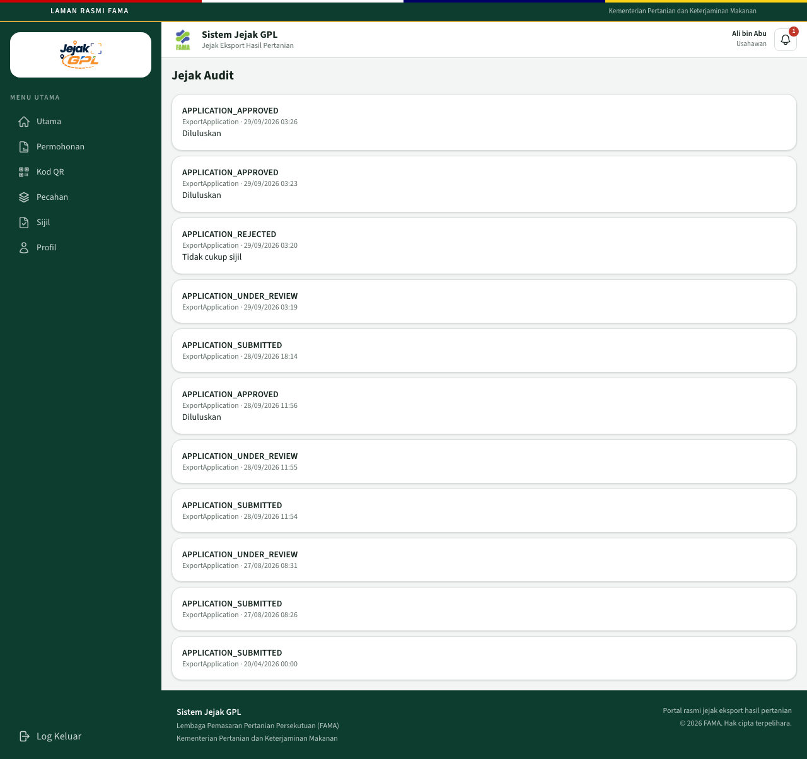

Each row is an action, the record type, the date and time, and a remark when one was stored. Actions you will see include:

| Action | When it is written |
|---|---|
| QR_GENERATED | A QR is created with a draft |
| APPLICATION_SUBMITTED | The usahawan clicks **Hantar** |
| APPLICATION_UNDER_REVIEW | An officer opens a submitted application |
| APPLICATION_APPROVED | The officer clicks **Sahkan** |
| APPLICATION_REJECTED | The officer clicks **Tolak** |
| LOT_SPLIT | A lot is split |
| LOT_ACCEPTED | The receiving company opens the public link and accepts the lot |

---

## 10. Pegawai FAMA — monitoring

Sign in with the role set to **FAMA**. The home page is **Utama FAMA**.

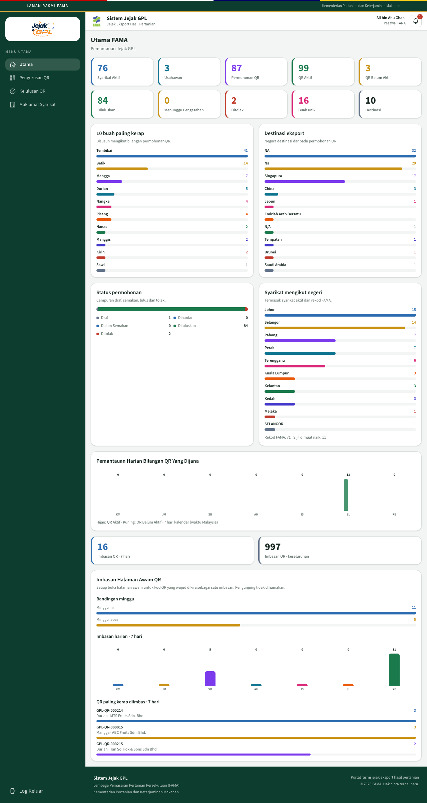

The tiles count companies, usahawan accounts, applications, active and inactive QR codes, approvals, rejections, and what is waiting. **Menunggu Pengesahan** opens the queue of applications still in review.

Below the tiles:

| Panel | What it shows |
|---|---|
| 10 buah paling kerap | Produce with the most QR applications |
| Destinasi eksport | Destination countries |
| Status permohonan | Mix of draft, sent, in review, approved, and rejected |
| Syarikat mengikut negeri | Companies by state, including FAMA-managed records |
| Pemantauan Harian Bilangan QR Yang Dijana | QR codes created over the last 7 days. Green is **Aktif**. Yellow is **Belum Aktif** |
| Imbasan QR | Opens of a real public QR page in the last 7 days, and the overall total |
| Imbasan Halaman Awam QR | The same scans as a chart, plus the QR codes opened most often |

Each open of a real public page counts as one scan. Visitors are not named.

The left menu:

- **Utama**
- **Pengurusan QR**
- **Kelulusan QR**
- **Maklumat Syarikat**

### Pengurusan QR

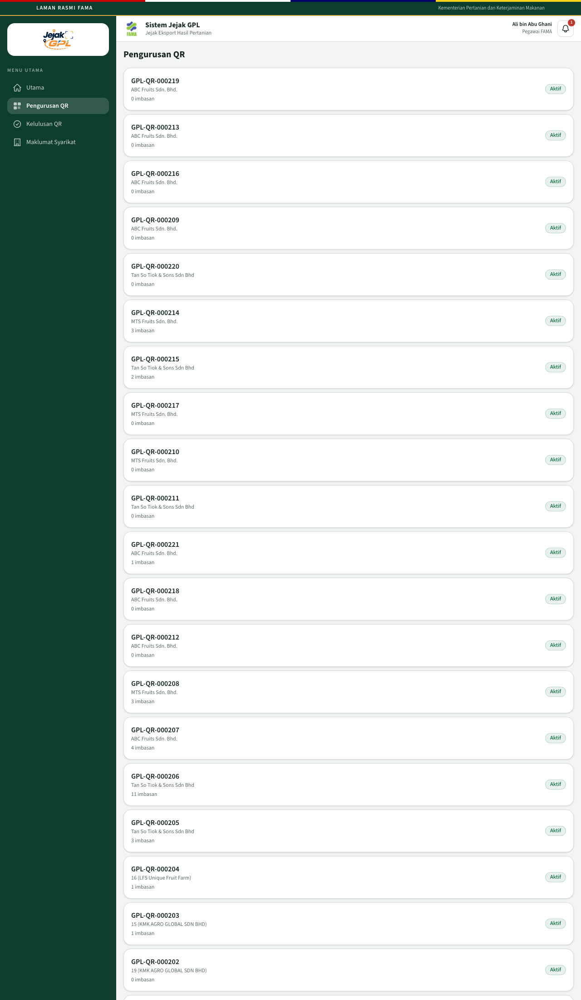

Every QR is listed with the holder, the number of public scans, and **Aktif** or **Belum Aktif**. Opening a row goes to that application’s summary.

---

## 11. Pegawai FAMA — review and decision

Open **Kelulusan QR**.


The list is every application FAMA can see: company, produce, and status. Open the row you want to review.

Opening an application that is **Dihantar** moves it to **Dalam Semakan** by itself. You do not click a separate “start review” button.

On a record that is still **Dihantar** or **Dalam Semakan**, the summary shows the product, company, farm, importer, and CoC number, plus the QR. Under that:

- **Catatan** — required when you reject. The placeholder says it is required if you reject.
- **Tolak** — rejects the application. An empty note shows **Catatan penolakan diperlukan.**
- **Sahkan** — approves it. You do not have to type a note. The system stores **Diluluskan**.

Approval and QR activation are one step. The officer does not activate the QR separately. The badge becomes **Diluluskan** and the QR becomes **Aktif**.

Rejection sets the status to **Ditolak** and leaves the QR **Belum Aktif**. The reason is kept on the decision.

After a decision, **Sahkan** and **Tolak** are no longer shown. **Keputusan** shows the outcome.

An approved record:

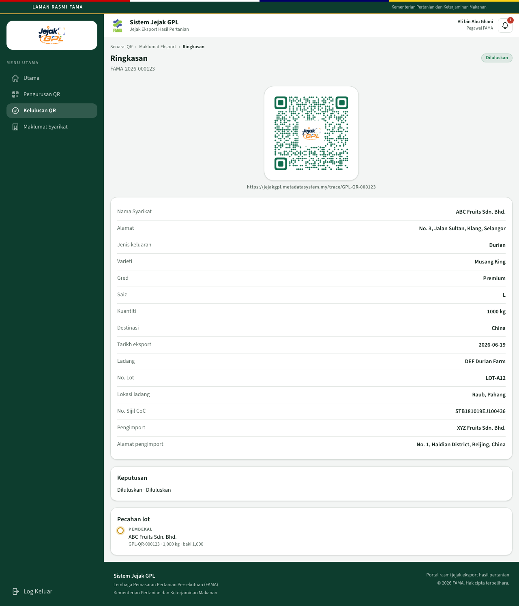

A rejected record, with the officer’s note:

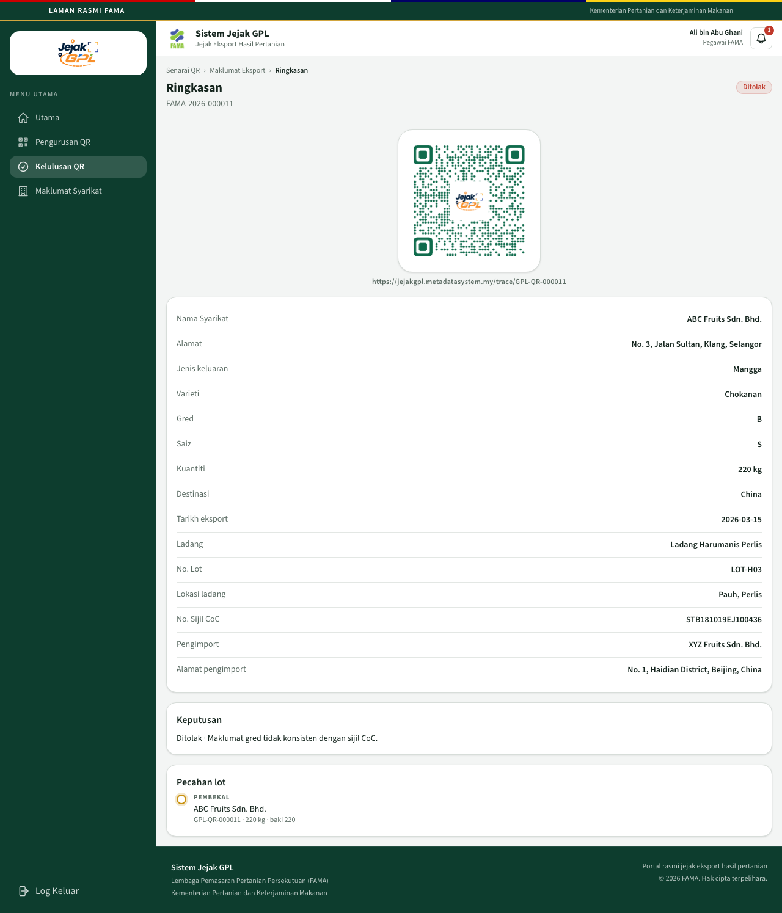

**Pecahan lot** on the same page uses the same chain as the usahawan’s lot screen: the original batch, then each piece, with the balance. Before the next company accepts, that piece says **Menunggu penerimaan**. FAMA can see where the batch went. The officer does not accept the lot for the holder.

---

## 12. Pegawai FAMA — companies and direct QR

Open **Maklumat Syarikat**.

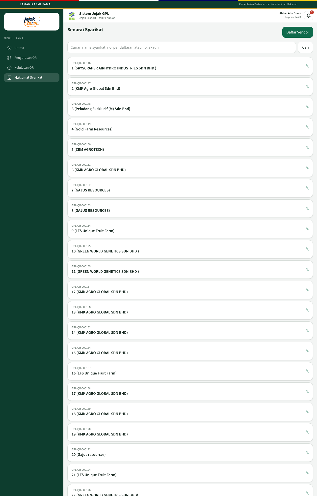

Search by company name, registration number, or account number, then click **Cari**. The search also runs as you type. Open a company to see its file.

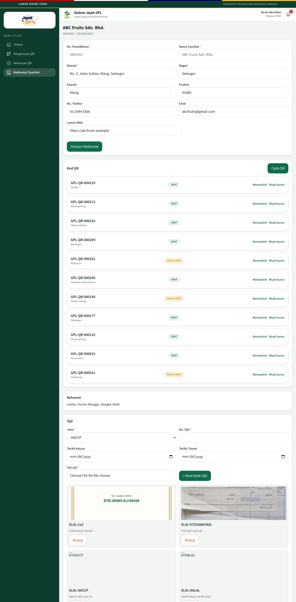

For a DagangNet company, **No. Pendaftaran** and **Nama Syarikat** stay read-only. Address, phone, email, and website can be updated with **Simpan Maklumat**.

The **Kod QR** list on this page has **Kemaskini** for the public fields of an approved QR, and **Muat turun** for the image. **Cipta QR** starts a new QR for this company.

Certificates can be uploaded or removed here, with the same types as the usahawan screen.

### Daftar Vendor

**Daftar Vendor** creates a company record that FAMA manages. It does not create an usahawan login.

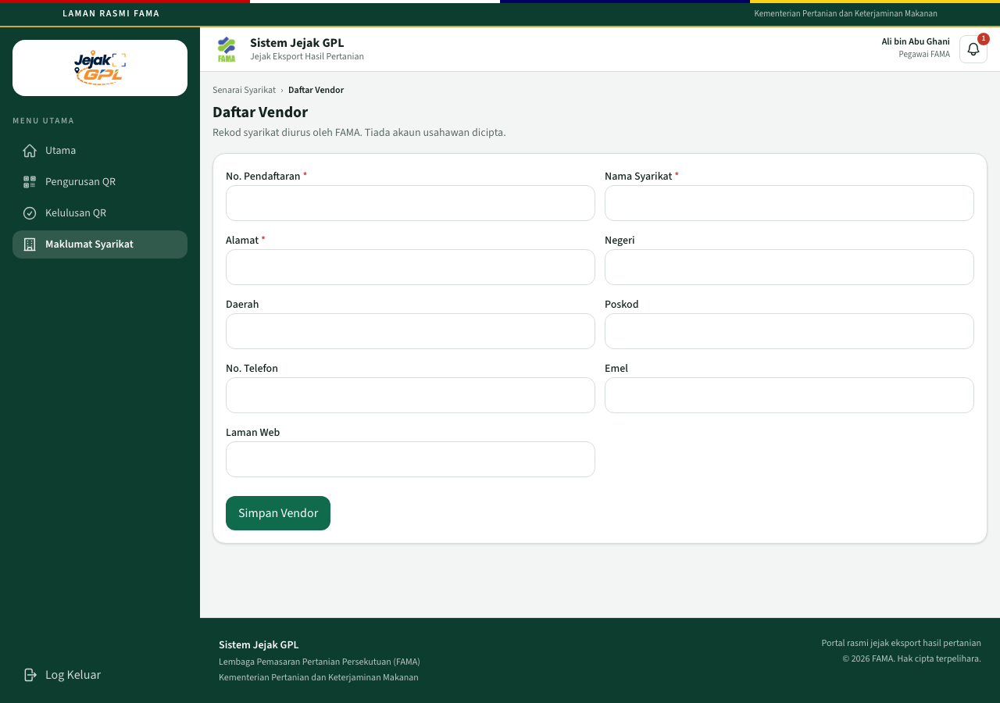

Fill the registration number, name, and address. State, district, postcode, phone, email, and website are optional. Click **Simpan Vendor**.

On a vendor that FAMA created, the registration number and name can be edited later. On a DagangNet company, those two fields stay locked.

### Cipta QR

From the company file, click **Cipta QR**. This path activates the QR immediately. It is the operations shortcut, for example when FAMA captures a vendor at an event. The ordinary path is still the usahawan’s application, then FAMA approval.

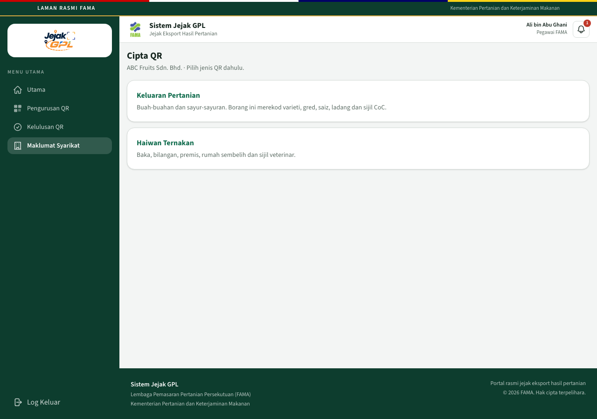

Choose **Keluaran Pertanian** or **Haiwan Ternakan**. The form is the same export form the usahawan uses. The button is **Cipta dan Aktifkan QR**.

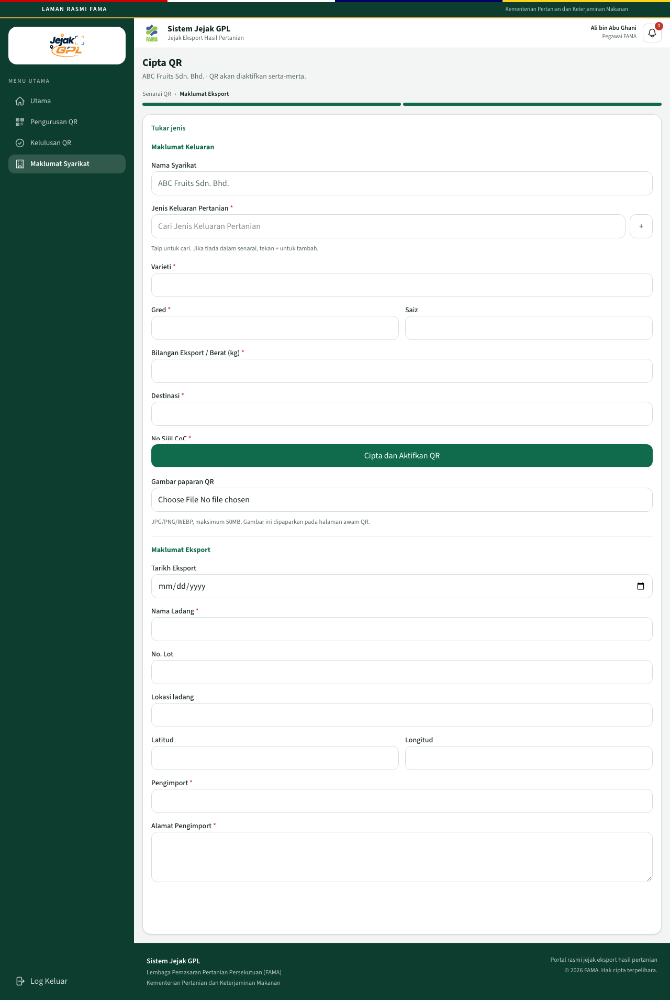

The new public page is already **Aktif**, because this path approves in one action.

### FAMA audit trail

The officer audit trail is not in the left menu. Open:

[https://jejakgpl.metadatasystem.my/fama/audit](https://jejakgpl.metadatasystem.my/fama/audit)

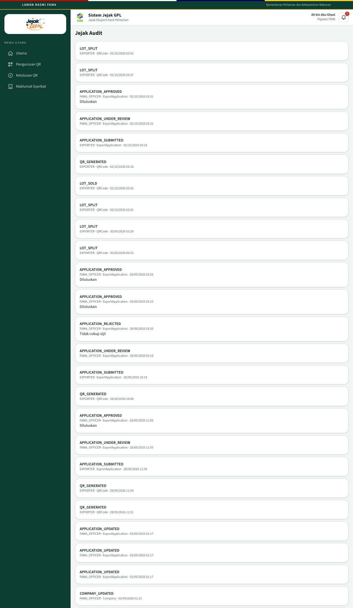

It uses the same action names as the usahawan audit, across all companies.

---

## 13. Public traceability page

Anyone with the link can open it. No sign-in. The address is:

```text
https://jejakgpl.metadatasystem.my/trace/GPL-QR-000015
```

Replace the code with the QR you want. Private account data is not on this page.

### QR not yet approved

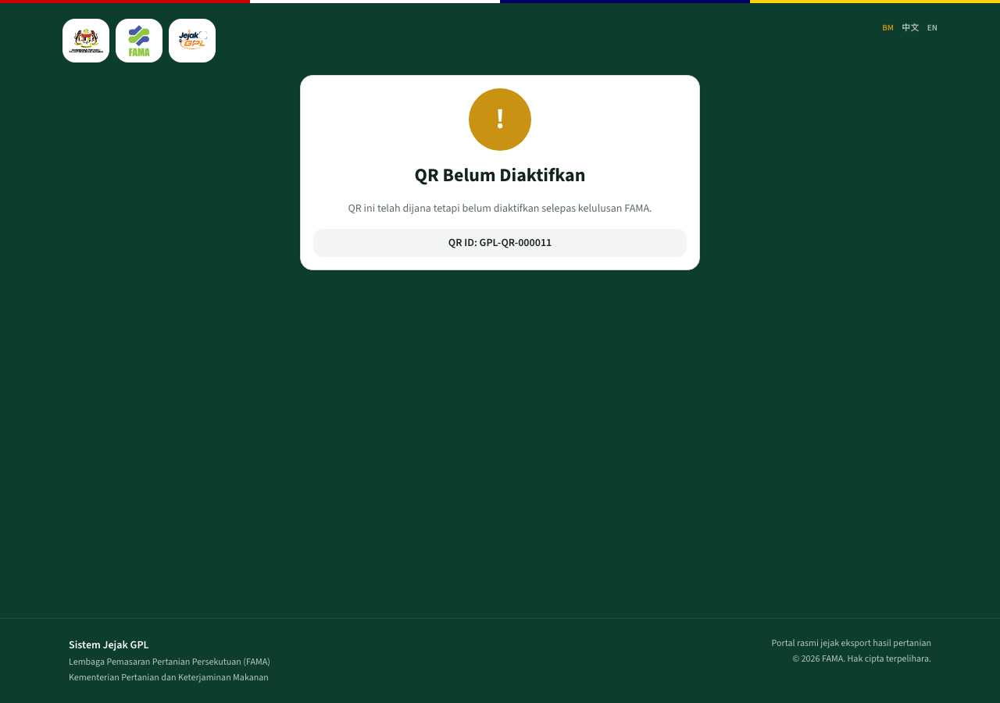

The title is **QR Belum Diaktifkan**. The text says the QR has been generated and is not yet active after FAMA approval. Only the QR ID is shown. Product, farm, and importer stay hidden. A rejected application looks the same to the public.

### Unknown code

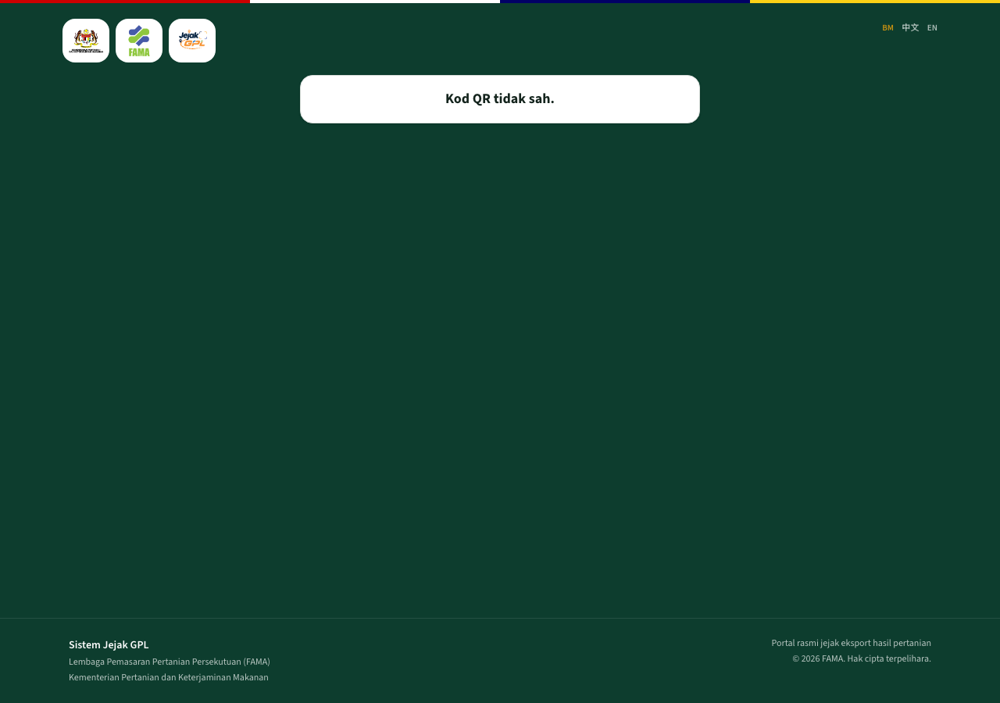

A code that does not exist shows **Kod QR tidak sah.**

### Active product page

On a wide screen the page is the desktop profile.

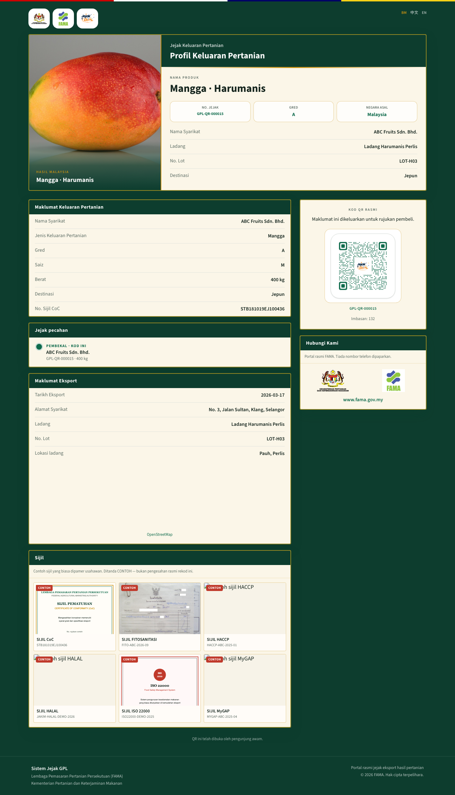

You will see:

- Product and variety, grade, and origin
- Company, farm, lot, and destination
- The official QR and the scan count
- **Maklumat Keluaran Pertanian** and **Maklumat Eksport**
- **Jejak pecahan** — the chain of holders. **Kod ini** is the code you opened
- A map when the farm has coordinates
- Certificates the company uploaded, with a note that they are copies the entrepreneur displayed, not a fresh check with an authority
- Nutrition, when that produce has it
- The agency strip and contact line

**BM**, **中文**, and **EN** at the top right switch the language of the same record.


When the lot has been split, **Jejak pecahan** shows each stop, the role, the quantity, and which code you are holding.

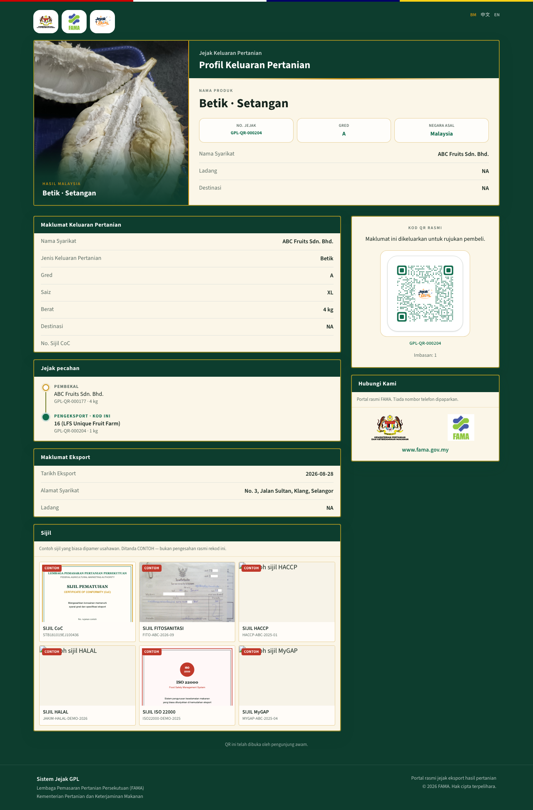

### Waiting for the next company

If a split has been saved and the receiving company has not opened the link while signed in, the public page says **QR Menunggu Penerimaan**. The product is hidden until that company accepts.

---

## 14. Phone layout

On a phone, the usahawan menu moves to the bottom of the screen: **Utama**, **Permohonan**, **Kod QR**, **Pecahan**, **Sijil**, **Profil**.

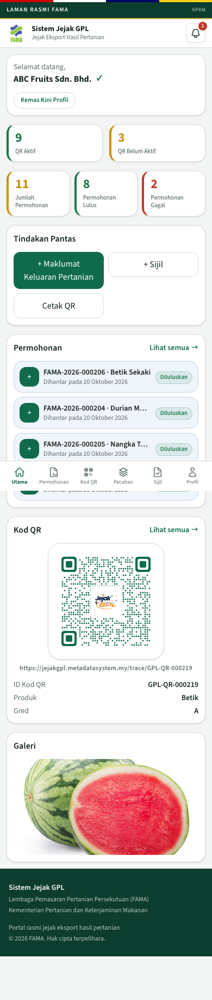

The public product page switches to a single column, the pamphlet layout.

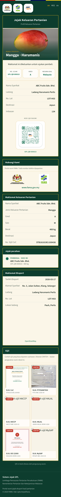

Pegawai FAMA on a phone uses the menu button in the header. That opens **Menu Utama** with **Utama**, **Pengurusan QR**, **Kelulusan QR**, **Maklumat Syarikat**, and **Log Keluar**. On a computer those links are the left menu, and the menu page tells you to use that side menu.

---

## 15. Statuses

Application status and QR status are separate.

### Application

| Status on screen | Meaning |
|---|---|
| Draf | The usahawan can still edit it. FAMA is not deciding yet |
| Dihantar | Sent to FAMA. The form is locked. The QR is still inactive |
| Dalam Semakan | An officer has opened it. **Sahkan** and **Tolak** are available |
| Diluluskan | Approved. The QR is **Aktif** |
| Ditolak | Rejected. The QR stays **Belum Aktif**. The reason is on the decision |

The path is Draf, then Dihantar, then Dalam Semakan, then either Diluluskan or Ditolak.

### QR

| Status on screen | Meaning |
|---|---|
| Belum Dijana | No QR yet |
| Belum Aktif | The QR ID and the public link exist. The public page does not show the product |
| Aktif | FAMA has approved, or a FAMA officer created the QR directly, or a consumer pack was sold. The product page is public |

A lot also shows **Dipegang** while the company holds a balance, and **Dijual** when that piece has been sold on.

---

## 16. Demonstration accounts

These accounts are on the live demonstration site. The role switch must match the account.

| Who | Role | Email | Password |
|---|---|---|---|
| Ali bin Abu, ABC Fruits Sdn. Bhd. | USAHAWAN | `ali@abcfruits.example` | `Exporter123!` |
| Siti Aminah, MTS Fruits | USAHAWAN | `siti@mtsfruits.example` | `Exporter123!` |
| Ali bin Abu Ghani, Pegawai FAMA | FAMA | `aliabu@fama.gov.my` | `Fama123!` |

The site already holds many real demonstration records, including approved QR codes such as `GPL-QR-000015` (Mangga Harumanis, active) and `GPL-QR-000011` (Mangga Chokanan, rejected and inactive). Creating an application, approving one, splitting a lot, or finishing **Daftar** for a company that already has a login writes into this shared site.

Useful public links:

| Link | What you see |
|---|---|
| `/trace/GPL-QR-000015` | Active mango page |
| `/trace/GPL-QR-000011` | QR Belum Diaktifkan |
| `/trace/GPL-QR-999999` | Kod QR tidak sah |

---

## 17. What this version does not do

- It does not call the live DagangNet or iFAMA systems. Company and staff search uses the built-in lists.
- It does not check a certificate with an issuing authority.
- It does not email a new password. **Lupa kata laluan** says so.
- It does not print to a hardware label printer. Download gives a PNG or PDF.
- It does not let a rejected application be edited and submitted again.
- It does not expire, suspend, or revoke a QR after activation.
- It does not show private account details on the public page.

---

## 18. Messages you may see

| Message | What to do |
|---|---|
| Emel atau kata laluan tidak sah. | Check the email and password |
| Peranan yang dipilih tidak sepadan dengan akaun ini. | Ali is **USAHAWAN**. The FAMA officer is **FAMA** |
| Tiada rekod dijumpai | The account number or identity card is not in the prototype list |
| Catatan penolakan diperlukan. | Type a reason, then click **Tolak** again |
| Permohonan ini bukan draf dan tidak boleh dikemaskini. | The application has been sent. File a new one if the details must change |
| Jumlah pecahan melebihi baki kuantiti | The pieces add up to more than the remaining quantity. Lower the quantity and save again |
| Hanya pemegang lot semasa boleh memecahkan atau menjual lot ini | Sign in as the company that currently holds that row |
| Lot belum aktif | That QR is not approved yet. Split it after **Sahkan** |
| QR Belum Diaktifkan | The public link is real, and FAMA has not approved it, or the application was rejected |
| QR Menunggu Penerimaan | Sign in as the receiving company and open the link again |
| Kod QR tidak sah. | The code is not in the system |
| Sila semak kata laluan. | On FAMA registration, the password and confirmation must match and be at least 8 characters |
| Sila semak kata laluan dan maklumat pengguna. | On usahawan registration, check the password and that a company was added |
